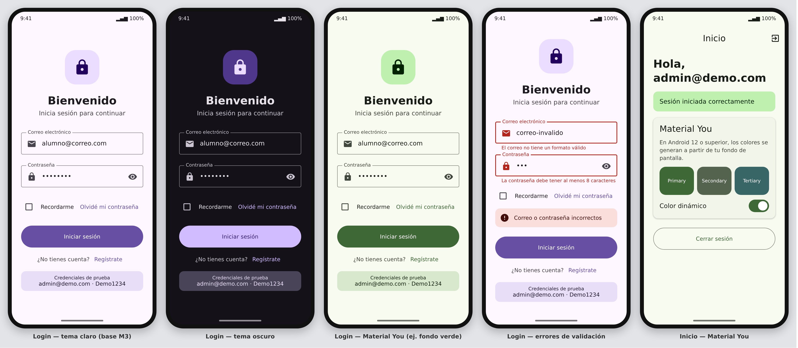

# Login M3 — Práctica de Interfaces Móviles

Prototipo de interfaz de **inicio de sesión** para Android, hecho con **Jetpack Compose**, **Material 3** y **Material You** (color dinámico).

## Características

- Pantalla de login con validación en tiempo real (correo y contraseña), mostrar/ocultar contraseña, "Recordarme", estado de carga y mensajes de error.
- Pantalla de inicio posterior al login que muestra la paleta activa y permite alternar el **color dinámico**.
- **Material You**: en Android 12+ (API 31) los colores se extraen del fondo de pantalla (`dynamicLightColorScheme` / `dynamicDarkColorScheme`). En versiones anteriores se usa la paleta base de Material 3.
- Tema claro y oscuro automáticos, ícono adaptativo con capa `monochrome` (íconos temáticos de Android 13+).
- Arquitectura **MVVM** con flujo de datos unidireccional (`StateFlow` + eventos por `Channel`).
- Pruebas unitarias de validación y del repositorio simulado.

## Credenciales de prueba

| Correo | Contraseña |
|---|---|
| `admin@demo.com` | `Demo1234` |

La autenticación es simulada (`FakeAuthRepository`, con 1.2 s de latencia).

## Cómo ejecutarlo

1. Abrir la carpeta del proyecto con **Android Studio** (Ladybug o más reciente) y esperar el *Gradle Sync*.
2. Seleccionar un emulador o dispositivo con **Android 8.0 (API 26) o superior**. Para ver Material You usar **API 31+** y cambiar el fondo de pantalla.
3. Pulsar **Run ▶**.

Por línea de comandos: `./gradlew assembleDebug` y `./gradlew test`.

Requisitos: JDK 17 (el que trae Android Studio), `compileSdk` 35, `minSdk` 26.

## Estructura

```
app/src/main/java/com/practica/loginm3/
├── MainActivity.kt          # Punto de entrada (edge-to-edge)
├── data/                    # FakeAuthRepository
├── domain/                  # AuthRepository, LoginValidator
└── ui/
    ├── LoginM3App.kt        # Raíz: tema + navegación por estado
    ├── login/               # LoginScreen, LoginViewModel, LoginUiState
    ├── home/                # HomeScreen
    └── theme/               # Color.kt, Type.kt, Theme.kt (Material 3 + Material You)
docs/
├── img/                     # Bocetos, wireframes, mockups y diagramas
└── capturas/                # Capturas de la app ejecutándose
```

## Diseño

| Fase | Archivo |
|---|---|
| Bocetos | [`docs/img/boceto_login.png`](docs/img/boceto_login.png) |
| Wireframes | [`docs/img/wireframes_login.png`](docs/img/wireframes_login.png) |
| Mockups | [`docs/img/mockups_resumen.png`](docs/img/mockups_resumen.png) |
| Arquitectura | [`docs/img/arquitectura.png`](docs/img/arquitectura.png) |
| Flujo de usuario | [`docs/img/flujo_usuario.png`](docs/img/flujo_usuario.png) |



## Tecnologías

Kotlin 2.0 · Jetpack Compose (BOM 2024.12) · Material 3 · Lifecycle ViewModel / StateFlow · Gradle Kotlin DSL con Version Catalog.
